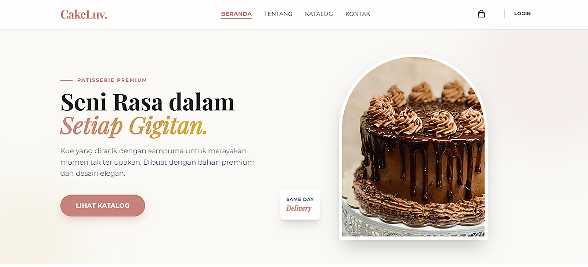
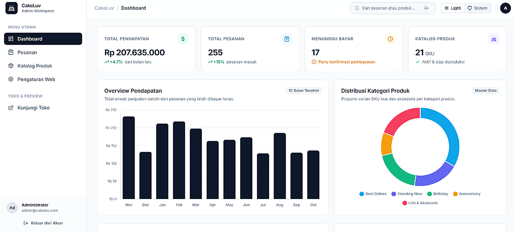

# 🍰 CakeLuv Patisserie - E-Commerce Platform


**CakeLuv Patisserie** adalah aplikasi E-Commerce toko kue premium modern yang dibangun menggunakan framework **Laravel 13** dan **Tailwind CSS v4**. Dilengkapi katalog produk interaktif, sistem keranjang dinamis, checkout otomatis dengan payment gateway **Midtrans Snap**, login Google OAuth, serta **Dashboard Admin Modern berbasis Shadcn-UI** dengan analitik omset 12 bulan dan manajemen pesanan.

---

## 📸 Preview Tampilan Aplikasi (HD)

<p align="center">
  <b>Etalase Beranda (Storefront Landing Page)</b><br>
  
</p>

<p align="center">
  <b>Dashboard Admin Modern (Shadcn-Admin Style)</b><br>
  
</p>

---

## ✨ Fitur Utama (Key Features)

### 🛍️ Sisi Pelanggan (Customer-Facing)

- **Katalog Produk Dinamis:** Menampilkan katalog kue artisan dan aksesoris pesta dengan filter kategori responsif.
- **Keranjang Belanja Interaktif:** Pengelolaan item keranjang fleksibel dengan fitur catatan khusus (_custom cake request_) pada setiap item.
- **Integrasi Payment Gateway:** Checkout instan menggunakan **Midtrans Snap API** (Mendukung Virtual Account bank, GoPay, QRIS, dll) dengan status transaksi otomatis.
- **Autentikasi Multi-Metode:** Sistem Login, Register, dan Profil aman berbasis Laravel Auth serta dukungan **Google OAuth (SSO)** via Laravel Socialite.
- **UI/UX Mewah & Modern:** Tampilan elegan dibangun dengan **Tailwind CSS v4** dan Vite 8, responsif mobile/desktop, animasi halus, dan navigasi yang intuitif.

### 📊 Sisi Admin (Dashboard & Manajemen)

- **Dashboard Visualisasi Data (Shadcn-Admin Style):** Metrik KPI omset, total order, grafik analitik batang penjualan 12 bulan, dan diagram doughnut kategori produk terlaris via **Chart.js**.
- **Manajemen Produk (CRUD):** Tambah, edit, update stok/status, serta sistem upload gambar produk secara terstruktur.
- **Manajemen Pesanan Real-Time:** Monitoring pesanan masuk dengan kemampuan pembaruan status transaksi (_Pending -> Paid -> Processed -> Shipped_).
- **Pengaturan Toko Dinamis:** Konfigurasi informasi kontak, banner, chef patissier, dan jam operasional langsung dari panel admin.

---

## 🛠️ Tech Stack & Arsitektur

- **Framework Backend:** Laravel 13.x (PHP 8.3+)
- **Arsitektur:** Modern MVC (Model-View-Controller) dengan Eloquent ORM, Service / Controller pattern, dan Middleware Route Protection.
- **Database:** MySQL dengan sistem Laravel Migrations, Factories, dan Database Seeders.
- **Frontend:** Laravel Blade Templating, Tailwind CSS v4, dikompilasi cepat menggunakan Vite 8.
- **Third-Party & Integrasi:**
  - **Midtrans Snap API:** Payment Gateway terintegrasi untuk checkout instan.
  - **Laravel Socialite:** Autentikasi Google OAuth single sign-on (SSO).
  - **Chart.js:** Visualisasi grafik omset 12 bulan dan kategori produk terlaris di Admin Panel.
  - **Shadcn-Admin UI Style:** Desain dashboard profesional berbasis palet Slate OKLCH dan komponen modern.

---

## 💡 Mengapa Proyek Ini Ada di Portfolio Saya?

Proyek ini mendemonstrasikan keahlian dalam merancang sistem _e-commerce_ full-stack berskala produksi menggunakan ekosistem modern **Laravel 13** dan **Tailwind CSS v4**. Menggabungkan arsitektur _clean code_ berbasis MVC, integritas data transaksional dengan Eloquent ORM, integrasi pembayaran pihak ketiga (Midtrans Snap), sistem autentikasi aman multi-metode (termasuk Google SSO), serta antarmuka admin bergaya **Shadcn-UI** yang intuitif dan kaya analitik data.

---

## 🚀 Panduan Instalasi (Local Development)

1. **Clone Repositori:**

   ```bash
   git clone https://github.com/pranataa-labs/CakeLuv.git
   cd CakeLuv/CakeLuv
   ```

2. **Install Dependensi:**

   ```bash
   composer install
   npm install
   ```

3. **Konfigurasi Environment:**
   - Salin file `.env.example` menjadi `.env`:
     ```bash
     cp .env.example .env
     php artisan key:generate
     ```
   - Sesuaikan konfigurasi database (`DB_DATABASE`, `DB_USERNAME`, `DB_PASSWORD`) dan kunci API Midtrans (`MIDTRANS_SERVER_KEY`, `MIDTRANS_CLIENT_KEY`) di file `.env`.

4. **Migrasi & Seeding Database:**

   ```bash
   php artisan migrate --seed
   ```

5. **Jalankan Aplikasi:**
   ```bash
   npm run build
   php artisan serve
   ```
   Aplikasi dapat diakses melalui `http://localhost:8000`.

---

**Akun Demo Admin:**

- **Email:** `admin@cakeluv.com`
- **Password:** `password`
